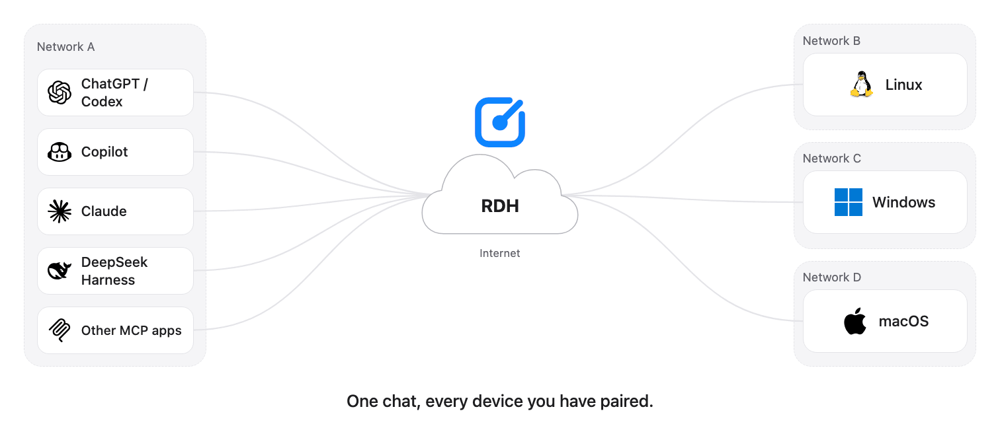

# Remote Device Hub for VS Code

Work on your other machines from VS Code chat. Remote Device Hub (RDH) lets the chat agent read and edit files, check processes, and run commands on the Linux, macOS, and Windows devices you have paired.



The Agent on each device connects out to RDH. There is no inbound firewall rule to open, no SSH session to keep alive, and nothing from VS Code to install on the device.

See [RDH terminology](docs/terminology.md) for the shared product, Agent, authorization and execution concepts.

## Get started

Requires VS Code 1.118 or later and a chat model that supports tools.

1. **Pair a device.** Install and start the [Remote Device Agent](https://github.com/easelian/remote-device-agent#install-and-run) on it, choose the folder to share, and approve the pairing in your browser.
2. **Sign in.** Install this extension. It asks once whether to connect, then opens your browser. If you decline, run **Remote Device Hub: Sign In** when you are ready.
3. **Ask.** Describe the task in chat:

   ```text
   List my devices
   Check free disk space on my build box
   Show the last 200 lines of logs/error.log on <device>
   In settings.toml on <device>, change log_level to debug and show me the diff
   ```

You never name a tool. The bundled skill tells the agent when and how to use RDH.

## What it can and cannot do

- **Files** stay inside the folders the device shares.
- **Commands** run only if the device allows them, with the OS permissions of the Agent's account. Shared folders do not sandbox commands.
- **Two gates.** The device decides whether changes and commands are allowed at all. VS Code then asks you to approve tool calls. To keep a session read-only, turn off the write and command tools in the chat tool picker.
- **The device must be online**, with its Agent running and connected.
- **Browser tools** are a preview and need an Agent with browser sessions enabled. See the [browser guide](https://github.com/easelian/remote-device-agent/blob/main/docs/browser.md).

## Commands

Search for **Remote Device Hub** in the Command Palette.

| Command | What it does |
| --- | --- |
| **Sign In** | Connects or reconnects your RDH account in the browser. |
| **Sign Out** | Removes the saved sign-in and asks RDH to revoke it. |
| **Show Status** | Checks that RDH still accepts the saved sign-in. |
| **Show Logs** | Opens the extension's log. |

## Troubleshooting

| What you see | What to do |
| --- | --- |
| RDH tools do not appear in chat | Run **Sign In**: the RDH server is listed only while you are signed in. Then check in **MCP: List Servers** that it is started, and in the tool picker that its tools are enabled. In Remote SSH, install the extension on the SSH host. |
| Sign-in does not finish | Run **Sign In** again. If VS Code offers **Copy Link**, open the link in your local browser. In Remote SSH, keep the window connected until the browser returns. |
| No devices are listed, or a device is offline | Check that you signed in with the account the device is paired to, and that the Agent is running on the device. |
| VS Code shows its own sign-in for RDH, such as **Dynamic Client Registration not supported** | Cancel it. It comes from another RDH entry, such as the agent plugin or a server you configured by hand, and not from this extension. Disable that entry in **MCP: List Servers**. |
| A command timed out and you cannot tell whether it ran | It may have run. Ask the agent to check the operation or call status before running it again. |

**Show Logs** records sign-in and connection events only. It never contains tool arguments, file contents, or credentials.

## Privacy

- The extension connects to `https://rdh.easelian.com` and its sign-in service. Sign-in uses OAuth with PKCE in your browser.
- Your sign-in is kept in VS Code's secret storage and renewed in the background. It is never written to settings, logs, or the package.
- Tool calls go from VS Code chat to RDH. Results can include remote file contents and command output, and the chat model you selected receives them.

## Other agent clients

This repository is also an Agent Plugins package (`plugin.json`, `mcp.json`, `skills/`) for agent clients that do not load VS Code extensions. Install it there with `/plugin install` from this repository. In VS Code, use the extension and leave the plugin disabled: each keeps its own sign-in.

## Upgrading from 0.0.27 or earlier

`@remote-device-hub` and the `remoteDeviceHub.chat.*` settings are gone, because VS Code has deprecated chat participants. Ask for the task directly instead. Your sign-in carries over.

## Contributing and license

[CONTRIBUTING.md](CONTRIBUTING.md) covers building, testing, and releasing. Easelian publishes this extension under the Apache License 2.0; see [LICENSE](LICENSE).
