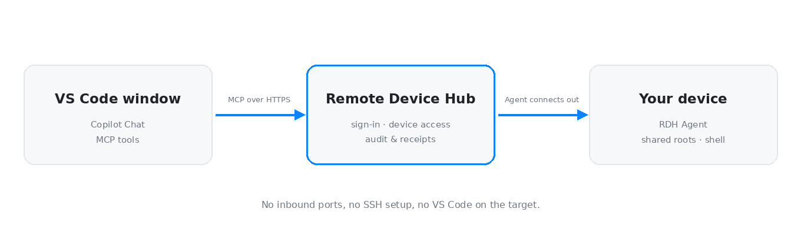

# Remote Device Hub for VS Code


**Work on your other machines without leaving Chat.** Remote Device Hub (RDH) lets Copilot read and edit files, inspect processes, and run permitted commands on the Linux, macOS, and Windows devices you have paired — from the VS Code window you are already in.



No inbound firewall rule, no SSH window to keep open, and no VS Code on the target. The Agent on the device connects out to RDH; this extension only needs an MCP connection and your account.

- **Ask in plain language** — "check free disk space", "tail the last 200 lines of app.log", "restart the service".
- **Two independent permission gates** — the device decides `allow_write` and `allow_shell`; VS Code asks you to approve tool calls.
- **Bounded by design** — file access stays inside the device's shared roots, every call returns a support ID, and writes can be traced with operation receipts.
- **Credentials stay local** — OAuth tokens live in VS Code SecretStorage and are never written into settings, logs, or the package.

## What you can ask for

| Task | Example prompt |
| --- | --- |
| See your devices | `List my authorized devices` |
| Check capacity | `Check free disk space on device <device ID>` |
| Read logs | `Show the last 200 lines of /var/log/myapp/error.log on my build box` |
| Find things | `Search the workspace for "TODO(rdh)" and list the files` |
| Change a setting | `In /etc/myapp/settings.toml change log_level to debug and show me the diff` |
| Run something | `Start make -j4 in workspace and stream the output` |

You do not need to name any tool: the `remote-device-operations` skill loads when a request targets a remote device.

## Quick start

1. **Pair the device.** Install and start the **RDH Agent** there, choose the shared directory, and approve the pairing in your browser. See the [Agent installation and pairing guide](https://github.com/easelian/remote-device-agent#install-and-run) and the [distribution guide](https://github.com/easelian/remote-device-agent/blob/main/docs/distribution.md).
2. **Connect this editor.** Install this extension. The first time VS Code looks for its server, the extension asks once whether to connect and then opens your browser to authorize. If you decline, it does not ask again: run **Remote Device Hub: Sign In** when you are ready. Valid credentials are reused.
3. **Ask.** Select a model that supports tool calls and send `List my authorized devices`. Then name the device: `Check free disk space on device <device ID>`.

Installing from a downloaded `.vsix` instead: run **Extensions: Install from VSIX**, then **Developer: Reload Window**. In Remote SSH, open the SSH window first and confirm **Remote Device Hub** appears under the SSH host ([managing extensions over SSH](https://code.visualstudio.com/docs/remote/ssh#managing-extensions)); use **Copy Link** if the browser cannot return to the forwarded callback.

### Limits worth knowing

- The Agent must be connected. File access stays inside its configured shared roots and permissions.
- Commands require command execution to be enabled on the device and run with the Agent account's OS permissions. **Shared roots do not confine shell commands.**
- Browser tools are a preview feature and need a compatible Hub plus an Agent with browser sessions enabled ([browser guide](https://github.com/easelian/remote-device-agent/blob/main/docs/browser.md)).
- `device_info` reports a device's OS, roots, `allow_write`, `allow_shell`, process limits, and browser availability before you rely on any of them.

## Use RDH in Chat

Ask for the task directly, for example `Check free disk space on device <device ID>`, and let the agent call the RDH tools. There is no `@` participant to mention.

| Surface | Harness or client | What it provides |
| --- | --- | --- |
| Extension-provided MCP server | Any VS Code harness that loads the extension | The `remote-device-hub` tools, authenticated by the extension |
| `remote-device-operations` skill | Any harness that supports Agent Skills | The RDH operating procedure: device lookup, files, processes, browser sessions, and operation receipts |
| Agent plugin package | Agent clients that do not load the extension | The same server definition and skill, authenticated by the client |

**In VS Code.** Tools come from the extension's `remote-device-hub` server: use **MCP: List Servers** to start it if needed, and enable its tools in the chat tool picker. Review any server trust prompt before starting it. Tool calls are approved through VS Code's own tool approvals; in versions that offer **Chat: Manage Tool Approval**, review approvals for tools from `remote-device-hub`. See [VS Code tool approvals](https://code.visualstudio.com/docs/agents/run/approvals#manage-tool-approvals). The device's own `allow_write` and `allow_shell` settings still apply.

**Other agent clients.** The repository root is an Agent Plugins 1.0 package: `plugin.json`, `mcp.json`, and `skills/remote-device-operations/`. Install it with `/plugin install` from the Git repository, or register a local checkout with the experimental `chat.pluginLocations` setting. The plugin authenticates through the client's own OAuth flow and carries no credentials.

**Upgrading from 0.0.27 or earlier.** Those versions included an `@remote-device-hub` chat participant with its own approval modes and time limit. VS Code has deprecated chat participants and the Local harness that runs them, and the Copilot harness does not load them, so the participant, the `remoteDeviceHub.chat.*` settings, and **Set Chat Permissions** were removed. Ask for the task directly instead; your saved sign-in is unchanged. The extension no longer has its own read-only mode: to prevent changes, disable the write and command tools in the tool picker, or turn off `allow_write` and `allow_shell` on the device.

### Use the extension and agent plugin together

RDH packages use the MCP server name `remote-device-hub` and the skill name
`remote-device-operations`. VS Code documents name-based MCP server
deduplication: the default choice favors the most specific definition, and
switching to another definition disables its same-name alternatives. Manage
enabled servers through the Extensions search `@mcp @installed` or
**Chat: Open Customizations**.
See [VS Code's server deduplication](https://code.visualstudio.com/updates/v1_118#_workspace-mcpjson-files-and-server-deduplication).

The extension publishes its server definition only while it has saved
credentials, and the definition carries them. A Copilot session can therefore
use the server directly, and the editor never starts its own OAuth flow for it.
While you are signed out, the server is not listed. The first time the editor
looks for it, the extension asks once whether to connect. After a declined,
cancelled, or failed attempt, or after **Sign Out**, it waits for **Remote Device
Hub: Sign In** and does not ask again on its own. A window with saved
credentials keeps them refreshed in the background.

Windows sharing the same extension credential store and host coordinate
sign-in, refresh, and sign-out through a process lock. They reuse a completed
sign-in and serialize refresh-token rotation. A canceled first sign-in does not
cause queued windows to open another browser. Separate profiles or extension
hosts may have independent storage and authentication.

Copilot Agent Host sessions also load plugin configuration through their own
runtime. Check the effective source in that session's **Chat: Open
Customizations > MCP Servers** controls; editor MCP controls do not necessarily
manage the runtime connection. Extension commands manage only the extension's
credentials. A plugin-managed connection uses the host's OAuth and sign-out
controls. These credential stores are not merged.

The extension provides the MCP server definition to the editor. You do not need to add a duplicate entry to `mcp.json`. VS Code may start the server on demand or when chat discovers tools. If `chat.mcp.autostart` is set to `never`, use **Start** in **MCP: List Servers**. Separate agent sessions that do not load the extension use their harness's MCP configuration. See [VS Code MCP configuration](https://code.visualstudio.com/docs/agents/reference/mcp-configuration).

### Extension commands

Search for **Remote Device Hub** in the Command Palette. These are the English command names.

| Command | What it does |
| --- | --- |
| **Sign In** | Connects or reconnects your RDH account through the browser. |
| **Sign Out** | Clears local sign-in and requests revocation of the saved RDH connection. |
| **Show Status** | Checks whether the RDH service accepts the saved credentials and displays sign-in status. |
| **Show Logs** | Opens the Remote Device Hub output channel. |

Command titles follow the VS Code display language in English, Simplified Chinese, and Traditional Chinese. The initial sign-in explanation is available in English and Simplified Chinese. Other runtime messages and service errors are in English.

## Troubleshoot a connection

| What you see | What to check |
| --- | --- |
| RDH tools are missing from Chat | Check the Extensions view in the current window. In Remote SSH, confirm RDH is installed on that host. Reload after installing, then start the server in **MCP: List Servers** and enable its tools in the tool picker. |
| Sign-in does not open or finish | Run **Remote Device Hub: Sign In** and confirm the access explanation. If offered, use **Copy Link** in the local browser. In Remote SSH, keep the SSH window connected while the browser returns to VS Code. Run **Show Status** after sign-in. |
| No devices are listed, or the target is offline | Check that you signed in to an account with access to the paired device and that the Agent is running. Use a fresh device list to confirm the device ID and status. |
| The editor shows its own sign-in for RDH, such as a **Dynamic Client Registration not supported** dialog | That sign-in belongs to a separately configured server or the agent plugin, not to this extension, which only publishes its server with credentials. Cancel it; the redirect URLs it offers are not pages to open. Disable that entry in **MCP: List Servers** and run **Remote Device Hub: Sign In**. |
| The native MCP server is missing or stopped | If RDH is not listed, you are signed out: run **Remote Device Hub: Sign In**. Otherwise, in **MCP: List Servers**, check the server source, then use **Start** or **Show Output**. A separately configured server with the same name has its own authentication. If a running connection still uses rejected credentials after **Show Status** succeeds, restart the MCP server. |
| Sign-in or the server start stalls | **Show Logs** opens RDH's output. The extension allows 30 seconds for each OAuth metadata request, credential check, or token refresh request. Tool calls run through VS Code's MCP client; use **Show Output** in **MCP: List Servers** for those. |
| A command was sent, but the result is unconfirmed | Check the original operation with `get_operation_status` using its operation ID or `list_operations` on the device. For an ordinary device call, use `get_call_status` with the Support ID or `list_calls`. Match the record to the device, action, and time before deciding whether to run it again. |

Stopping a chat, reloading VS Code, or timing out does not undo a command already sent to a device. A successful `start_process` confirms that the job started. Use `read_process` with the returned job ID to check output and completion. When reporting a problem, include the tool name and any operation or Support ID. The extension's log records authentication events, not tool arguments, file contents, or credentials.

## Account access and data

The extension connects to `https://rdh.easelian.com/mcp` and discovers the OAuth issuer from the MCP resource metadata. OAuth sign-in uses PKCE and opens in the local browser, including in a Remote SSH window. The extension stores credentials in VS Code SecretStorage, scoped to the MCP resource and bound to the issuer. Sign-in grants the extension access to the account's authorized devices. Pairing a device is a separate approval.

After the extension's authentication session has been used, it refreshes credentials in the background while the extension host is running. When the issuing service supports refresh recovery and recovery data is available, the extension can retrieve the result of an interrupted rotation without a new sign-in. Use **Sign In** if the issuer changes or the saved credentials cannot be renewed. **Sign Out** clears local credentials first and asks the authorization service to revoke the connection. If revocation cannot be confirmed, use the RDH account settings to revoke the connection.

Tool calls and their results travel between VS Code's chat and RDH through VS Code's MCP client; the extension supplies the connection and does not see them. Results may contain remote file contents, paths, and command output, which the selected chat model receives.

## Development

This section is for contributors. Using the extension needs none of it.

`npm run format` formats maintained sources and tests. `npm run style:check`
checks formatting and lint rules without editing files; `npm run lint` runs only
lint rules. Biome is pinned as a development dependency. The common convention
is two spaces, single quotes, semicolons, trailing commas, and one statement per
line. Type-only imports are explicit; explicit `any` and `@ts-ignore` are rejected.
Generated files and third-party code are outside the formatting scope.

From the extension repository root, use Node.js 22.12 or later; the CI and release workflows use the current Node.js 22. Packaging needs that minimum because `@vscode/vsce` 4 loads ES modules with `require`.

```bash
npm ci
npm run compile     # Or use npm run watch during development
npm test            # Requires permission to listen on temporary 127.0.0.1 ports
npm run package:vsix
```

Press `F5` to launch the Extension Development Host. With no saved credentials, confirm that the first discovery shows the access explanation before any browser opens, and that no RDH server is listed until sign-in completes. Choose **Continue** to open browser authorization, or cancel and use **Remote Device Hub: Sign In** when ready to retry. Regression tests use simulated VS Code APIs and authentication responses, real HTTP callbacks, and forwarding between different local ports. They do not use real accounts or replace browser testing in an actual Remote SSH session.

The automated tests do not execute VS Code's server selection. To validate
coexistence, install both the VSIX and the RDH agent plugin in the target client
and harness. Check the active MCP source and tool availability, switch sources,
and repeat after reloading and with multiple windows. A minimum-version
declaration does not establish that these client behaviors have been verified.

To exercise the plugin package instead of the extension, register this checkout with the experimental `chat.pluginLocations` setting and enable it, start a Copilot session, and run `/remote-device-hub:remote-device-operations`. `npm test` validates `plugin.json`, `mcp.json`, and every `SKILL.md`.

Maintain the operating skill and its references in this repository under
`skills/remote-device-operations/`. Both the VSIX and this repository's agent
plugin package include these local files. `npm test` checks their identity,
extension contribution, and referenced procedures. CI runs these checks through
`npm test`.

This repository is the single source of that skill. With the other plugin
checkouts next to this one, `npm run skill:sync` copies it into them and
`npm run skill:check` reports drift without writing; pass `-- --target <checkout>`
to select checkouts and `-- --workspace <dir>` when they live elsewhere. Run the
check before a coordinated release. The only permitted differences are the
host-specific replacements listed in `scripts/sync-skill.cjs`, and each must
match the source exactly once. Currently synced: `remote-device-plugin-claude`.
The Codex and DSH distributions carry their own skill text and are not synced.
CI has only this checkout, so it verifies the replacements still apply but
cannot compare the other repositories.

TypeScript enables `strict`, `noUncheckedIndexedAccess`, and `exactOptionalPropertyTypes`. JSON, saved credentials, and OAuth responses enter through `src/boundaries.ts` as `unknown` and are checked before use.

With the Hub's development dependencies installed and `RDH_TEST_POSTGRES_DSN` pointing to a disposable PostgreSQL database, also verify sign-out against a disposable local Hub using the compiled extension:

```sh
RDH_SERVER_ROOT=/path/to/remote-device-server
PYTHONDONTWRITEBYTECODE=1 "$RDH_SERVER_ROOT/.venv/bin/python" -m pytest \
  -q -p no:cacheprovider -c "$RDH_SERVER_ROOT/pyproject.toml" \
  -o "pythonpath=$RDH_SERVER_ROOT/tests/support $RDH_SERVER_ROOT $RDH_SERVER_ROOT/tests" \
  test/server/test_signout.py
```

The integration tests use the Hub's reference service and simulated discovery metadata. They cover ordinary sign-out, rotation before sign-out, lost refresh responses, and lost revocation responses. They check that the entire authorization is revoked, cached recovery cannot restore it, and other connections remain valid.

For the split-service integration test, set `RDH_TEST_RUST_AUTH` and `RDH_TEST_RUST_MIGRATE` to matching Server binaries and run the same pytest command with `test/server/test_split_auth.py`. It uses the real Auth service and a simulated MCP Gate to verify discovery, first sign-in, refresh, and revocation.

### Releasing

`.github/workflows/release.yml` runs on every push to `main`. When `package.json`
names a version that has no GitHub Release, it checks style, runs the tests,
packages the VSIX, creates the release `v<version>`, and publishes that same file
to the VS Code Marketplace. A push that does not change the version does nothing.

Marketplace publishing uses Trusted Publishing: the job exchanges its GitHub OIDC
token for a short-lived credential, so the repository stores no publishing
secret. It needs a policy on the `easelian` publisher (**Trusted Publishing** in
the [publisher management page](https://marketplace.visualstudio.com/manage/publishers/))
with repository owner `easelian`, repository `remote-device-plugin-vscode`,
workflow `release.yml`, and no environment. Without that policy the release is
still created and only the publishing step fails.

To publish a version whose release already exists, run the workflow manually
from `main` (**Actions > Release VSIX > Run workflow**). It downloads the VSIX
from the release and publishes it; a version already on the Marketplace is
skipped.

## Project layout

| File | Purpose |
|---|---|
| `src/extension.ts` | Extension activation, commands, and MCP provider integration |
| `src/authSession.ts` | Authentication state, refresh recovery, timers, and disposal |
| `src/credentialStore.ts` | SecretStorage formats and conditional credential cleanup |
| `src/authCallback.ts` | Temporary OAuth callback server |
| `src/requestDeadline.ts` | Deadlines for authentication requests |
| `src/boundaries.ts` | Validation for saved credentials and OAuth responses |
| `.vscode/launch.json` | F5 launch configuration |
| `package.json` | Extension metadata, MCP provider, skill contribution, and commands |
| `package.nls*.json` | Translations for command titles |
| `scripts/sync-skill.cjs` | Copies the operating skill to the other plugin checkouts, or checks them for drift |
| `plugin.json`, `mcp.json` | Agent Plugins 1.0 package for clients that do not load the extension |
| `skills/remote-device-operations/` | Locally maintained RDH operating skill and references, shipped by the plugin and by `contributes.chatSkills` |

## License

Easelian publishes this extension under the Apache License, Version 2.0. See [LICENSE](LICENSE) for the full text.
